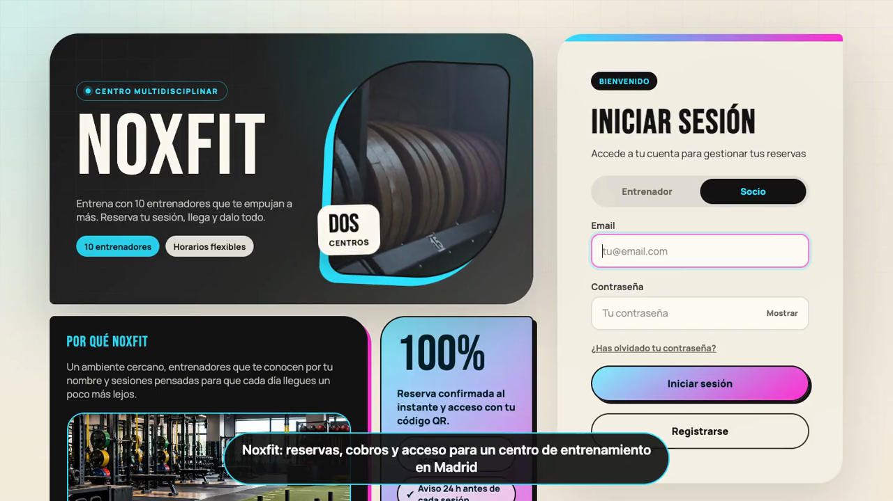
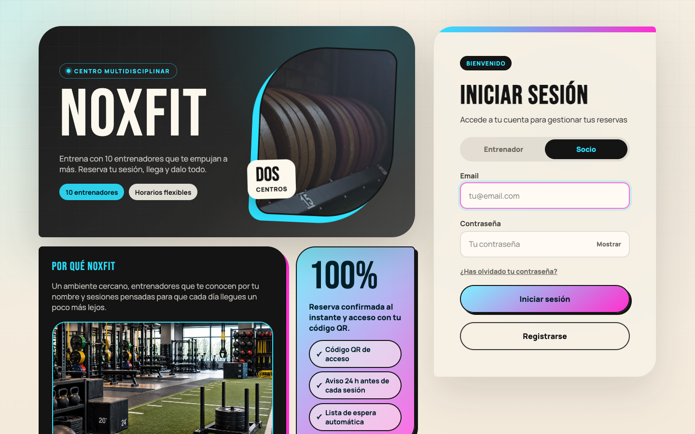
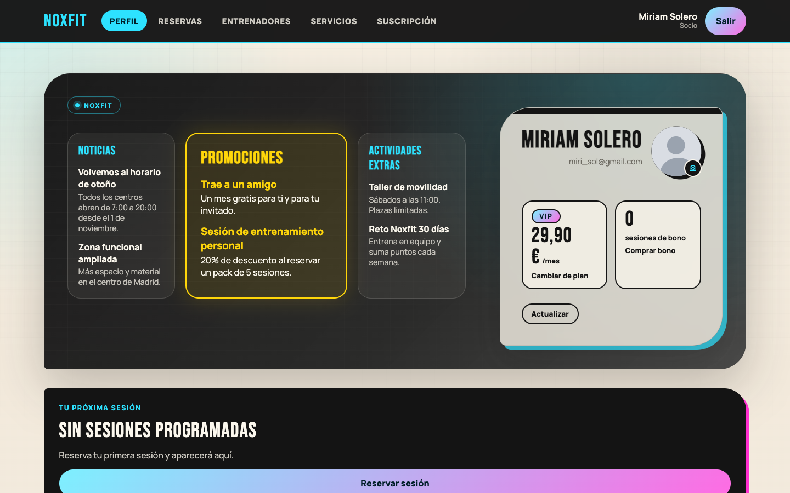
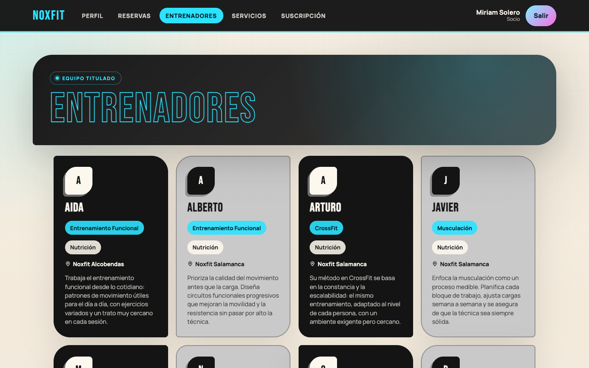
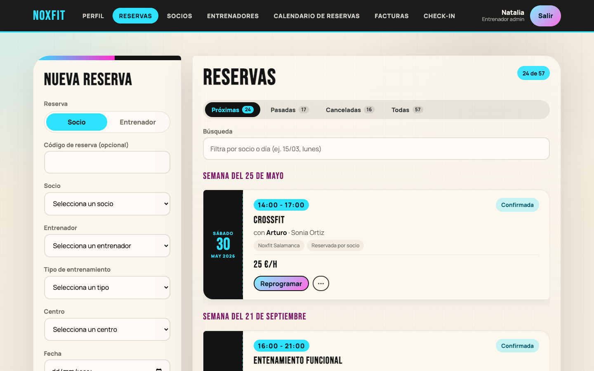
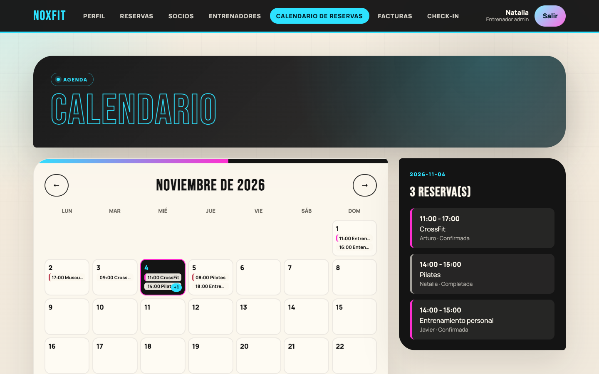
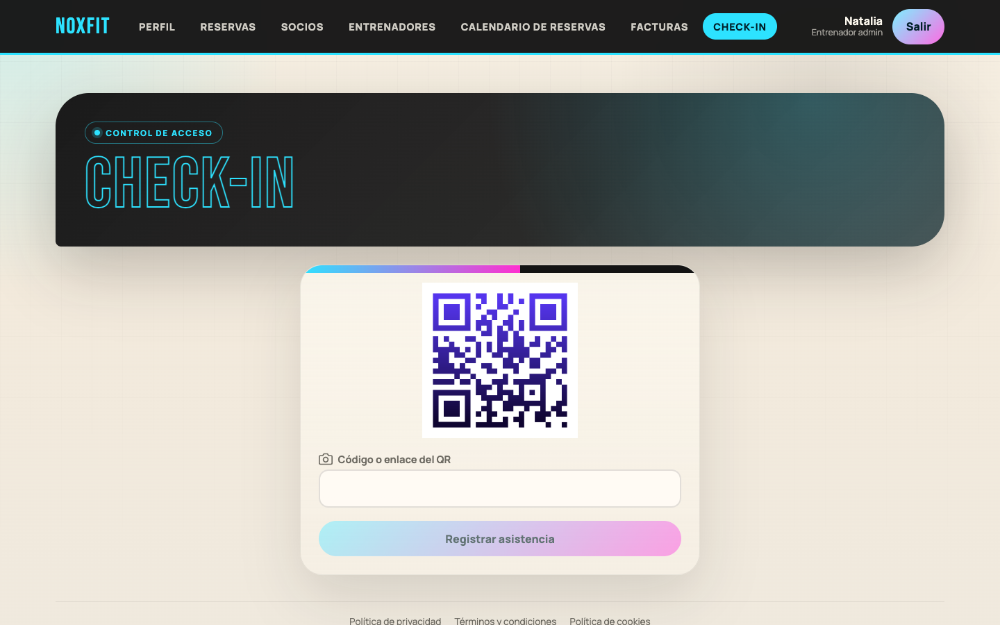
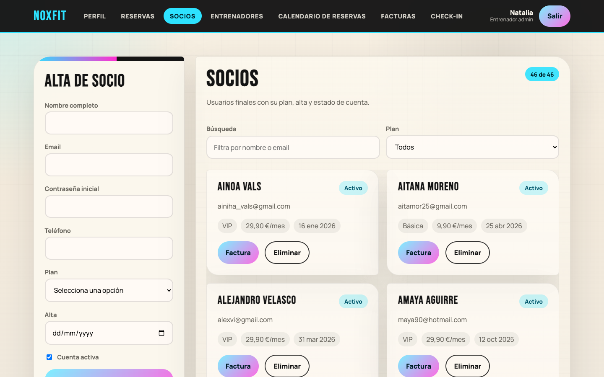
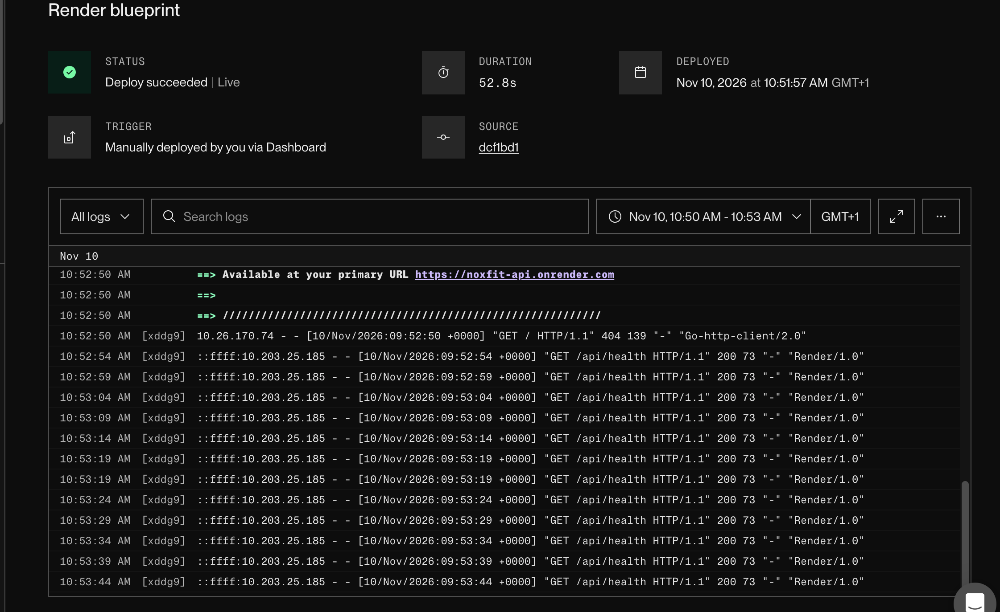
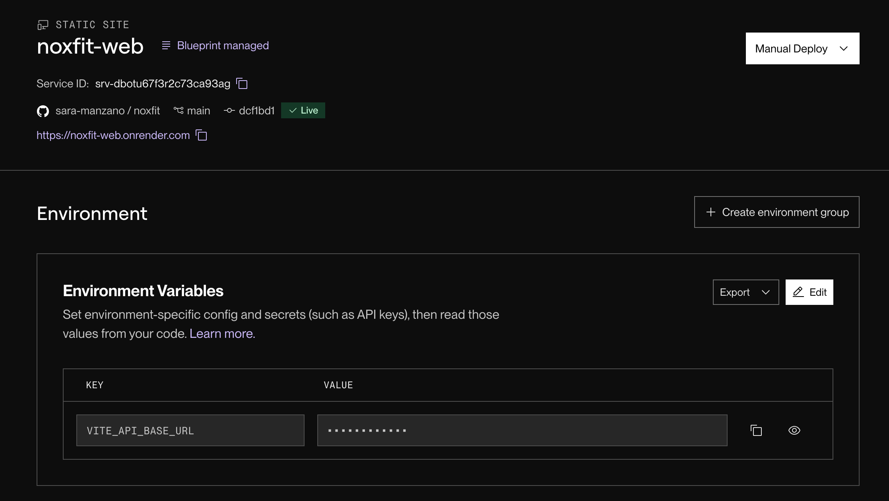

# Noxfit

Noxfit es la aplicación de un centro de entrenamiento con dos sedes en Madrid. Los socios reservan sesiones con sus entrenadores, y los entrenadores llevan la agenda, los socios y los cobros. Aquí está todo: la API y el panel web.

El backend está hecho con Express 5 y MongoDB (Mongoose), y se autentica con JWT. Todas las rutas cuelgan de `/api`. El frontend es una app de React que vive en `frontend/`.

Lo que se puede hacer ahora mismo: reservar sesiones sin que se solapen, apuntarse a una lista de espera cuando una franja está llena, entrar al centro con un QR, recibir avisos por email (con recordatorio 24 horas antes), pagar con Stripe (suscripción o bono de sesiones) y generar la factura mensual de cada socio en PDF.

## Sobre el proyecto

Noxfit es mi proyecto final. Quería construir algo parecido a lo que usaría un gimnasio de verdad, no solo un CRUD de ejemplo, así que le di forma de producto: tiene roles con permisos distintos, pagos reales (en modo de pruebas de Stripe), emails, documentación de la API y tests automáticos.

Las decisiones que más me importaron fueron que las reservas no se pisen entre sí, que los pagos sean seguros frente a avisos repetidos de Stripe y que la API no filtre información que no debe. Todo eso está explicado más abajo, en [Reglas de negocio](#reglas-de-negocio).

## Demo en vídeo

<video src="docs/demo/noxfit-demo.mp4" poster="docs/demo/poster.png" controls width="100%">
  <a href="docs/demo/noxfit-demo.mp4"></a>
</video>

[Abrir el vídeo de demostración](docs/demo/noxfit-demo.mp4) (2 min 47 s, con rótulos explicativos). Recorre:

- el acceso y el perfil de un socio, el directorio de entrenadores y el catálogo de servicios
- una reserva completa: crear, ver el código QR, reprogramar y cancelar
- la suscripción, los bonos de sesiones y las facturas
- el panel del entrenador admin: reservas, calendario, socios, entrenadores, facturas y check-in
- la documentación de la API en Swagger UI

## Capturas

Página de inicio y acceso:



Vista de un socio:





Vista de un entrenador admin:









## Quién puede hacer qué

Hay tres perfiles, y lo que ven y pueden tocar cambia según cuál sea:

| | Socio (member) | Entrenador | Entrenador admin |
| --- | --- | --- | --- |
| Reservar, cancelar y reprogramar | Las suyas (con ventana de antelación) | Las suyas | Todas |
| Lista de espera | Sí | Ver las de sus sesiones | Ver y gestionar |
| Pagar suscripción y bonos | Sí | No | No |
| Validar check-in con QR | No | Sus reservas | Todas |
| Gestionar socios y entrenadores | No | No | Sí |
| Facturas mensuales | La suya | De cualquier socio | De cualquier socio |
| Editar noticias y promociones | No | Sí | Sí |

## Con qué está hecho

- Node.js 20.19+ y Express 5
- MongoDB con Mongoose
- React 19 con Vite
- JWT para las sesiones y bcryptjs para las contraseñas
- express-rate-limit para frenar abusos en el login y helmet para las cabeceras de seguridad
- nodemailer para los emails
- Stripe para los pagos
- Cloudinary para los avatares (se suben desde el frontend y la API solo guarda la URL)
- PDFKit para generar las facturas en PDF
- Leaflet para el mapa de los centros y `qrcode` para los códigos QR
- OpenAPI 3.1 con Swagger UI para documentar la API
- Tests con el runner de Node, Supertest y mongodb-memory-server

## Cómo está organizado

Esto es lo que hay en cada carpeta:

```text
src/
  server.js                -> arranque del servidor
  app.js                   -> middlewares, rutas y manejo de errores
  config/                  -> auth, base de datos, ids, mailer, Stripe, URL de la app, validaciones
  controllers/             -> lógica de cada endpoint
    accountControllerHelpers.js -> CRUD y login que comparten members y trainers
  routes/                  -> definición de endpoints
  middleware/              -> auth, validación, rate limiters, 405
  models/                  -> esquemas e índices de Mongoose
  services/                -> reglas de negocio (conflictos de agenda, lista de espera, bonos, facturas...)
  jobs/                    -> recordatorios 24 h antes
  http/                    -> helpers de respuestas y errores
scripts/
  seed.js                  -> carga inicial desde el Excel o los CSV
  build-workbook.js        -> genera el Excel a partir de los CSV
  check-openapi.js         -> valida el contrato OpenAPI
frontend/
  src/                     -> app React (api, app, components, hooks, lib, styles)
docs/
  demo/                    -> vídeo de demostración y su miniatura
  screenshots/             -> capturas de la app para este README
.github/workflows/
  openapi-contract.yml     -> valida el contrato OpenAPI en CI
data/
  *.csv                    -> datos de partida
  noxfit-data.xlsx         -> Excel que genera el seed
test/
  *.test.js                -> tests unitarios y de integración
```

## Modelo de datos

Hay seis colecciones en MongoDB:

- **Member**: socio, con su plan (`membership_type`), saldo de bonos (`session_credits`) y datos de Stripe
- **Trainer**: entrenador, con su actividad, su centro y si es admin
- **Reservation**: sesión entre un member y un trainer en una fecha y franja; guarda el estado, el precio y si se pagó con un bono
- **Waitlist**: persona esperando una franja llena; cuando se libera una plaza pasa a reserva
- **SessionPackPurchase**: registro de cada bono pagado; sirve para que el webhook de Stripe no sume dos veces el mismo pago
- **Highlights**: noticias, promociones y actividades que se muestran en el perfil

Las reservas y la lista de espera apuntan a members y trainers por su `_id` interno, pero hacia fuera la API siempre usa los identificadores propios (`member_id`, `trainer_id`, `reservation_id`).

## Requisitos

Necesitas:

- Node.js 20.19 o superior
- una instancia de MongoDB a la que puedas llegar con `MONGODB_URI` (en local sirve una instalación normal o un contenedor)

## Variables de entorno

Copia este ejemplo en un `.env` en la raíz del proyecto y ajusta los valores. Los vacíos son opcionales:

```env
MONGODB_URI=mongodb://127.0.0.1:27017/noxfit
JWT_SECRET=replace-with-a-long-random-secret
TRAINER_BOOTSTRAP_TOKEN=replace-with-a-one-time-bootstrap-token
SEED_DEFAULT_PASSWORD=change-me-before-seeding
SEED_ADMIN_TRAINER_ID=
PORT=3000
DB_NAME=
APP_URL=http://localhost:5173
SMTP_HOST=
SMTP_PORT=587
SMTP_SECURE=false
SMTP_USER=
SMTP_PASS=
MAIL_FROM=Noxfit <no-reply@noxfit.es>
CANCELLATION_WINDOW_HOURS=2
REMINDERS_ENABLED=true
STRIPE_SECRET_KEY=
STRIPE_WEBHOOK_SECRET=
STRIPE_PRICE_BASICA=
STRIPE_PRICE_PREMIUM=
STRIPE_PRICE_VIP=
```

Sin estas dos la API no arranca:

- `MONGODB_URI`
- `JWT_SECRET`

Solo si vas a crear el primer trainer admin por la API (no hace falta si usas el seed):

- `TRAINER_BOOTSTRAP_TOKEN`

El resto son opcionales:

- `PORT`: puerto HTTP; por defecto `3000`
- `SEED_DEFAULT_PASSWORD`: contraseña que usa el seed para las filas que no traen `password`. Si no la defines y hay una fila sin contraseña, el seed se detiene con un error
- `SEED_ADMIN_TRAINER_ID`: selecciona qué trainer del CSV será admin inicial
- `SEED_RESET`: con valor `true` equivale a pasar `--reset` al seed
- `SEED_WORKBOOK_PATH`: Excel alternativo para el seed (ruta absoluta o nombre de archivo dentro de `data/`)
- `DB_NAME`: sobrescribe el nombre de base de datos de `MONGODB_URI`
- `CORS_ORIGIN`: orígenes permitidos separados por comas (p. ej. `https://noxfit.es`). En desarrollo, si no la defines, se acepta cualquier origen; con `NODE_ENV=production` el servidor se niega a arrancar sin ella
- `TRUST_PROXY`: número de proxies (o lista de IPs) que hay delante de la API. Hace falta para que el rate limiting vea la IP real del cliente y no la del proxy
- `APP_URL`: URL pública del frontend; se usa para montar el enlace del email de recuperación de contraseña. Por defecto `http://localhost:5173`
- `SMTP_HOST`, `SMTP_PORT` (por defecto `587`), `SMTP_SECURE`, `SMTP_USER`, `SMTP_PASS`: servidor SMTP para enviar emails. Si no defines `SMTP_HOST`, no se envía nada y el enlace de recuperación aparece en la consola del servidor, que es lo cómodo para desarrollar
- `MAIL_FROM`: remitente de los emails; por defecto `Noxfit <no-reply@noxfit.es>`
- `CANCELLATION_WINDOW_HOURS`: horas mínimas de antelación para que un member pueda cancelar o reprogramar; por defecto `2`
- `REMINDERS_ENABLED`: con valor `false` desactiva el job que envía recordatorios 24 h antes
- `STRIPE_SECRET_KEY`, `STRIPE_WEBHOOK_SECRET`, `STRIPE_PRICE_BASICA`, `STRIPE_PRICE_PREMIUM`, `STRIPE_PRICE_VIP`: pagos y suscripciones con Stripe (más detalles en la sección Billing)
- `SESSION_PACK_5_PRICE_CENTS`, `SESSION_PACK_10_PRICE_CENTS`: precio en céntimos de los bonos de sesiones; por defecto `4500` y `8000`

Variables del frontend (`frontend/.env`):

- `VITE_API_BASE_URL`: URL base de la API; si no la defines, en desarrollo es `http://localhost:3000/api` y en la versión compilada `/api`
- `VITE_CLOUDINARY_CLOUD_NAME` y `VITE_CLOUDINARY_UPLOAD_PRESET`: necesarias para subir avatares a Cloudinary

Ejemplo de `frontend/.env`:

```env
VITE_API_BASE_URL=http://localhost:3000/api
VITE_CLOUDINARY_CLOUD_NAME=
VITE_CLOUDINARY_UPLOAD_PRESET=
```

Para los avatares crea una cuenta gratuita en Cloudinary y, en los ajustes de subida, un *upload preset* sin firma (`unsigned`). Si no lo configuras, todo funciona igual salvo la subida de fotos.

## Instalación y arranque

Instala las dependencias del backend y del frontend:

```bash
npm install
npm install --prefix frontend
```

Con el `.env` listo, arranca la API (con recarga automática) y, en otra terminal, el frontend:

```bash
npm run dev
npm run frontend:dev
```

Si prefieres arrancar la API sin recarga, usa `npm start`.

Orden recomendado la primera vez: instalar, crear el `.env`, ejecutar `npm run seed` para tener datos, y entonces arrancar API y frontend. Para comprobar que la API responde, abre `http://localhost:3000/api/health`.

La API queda en `http://localhost:3000/api` y el frontend en `http://localhost:5173`. Si cambias el puerto de la API, pon la nueva URL en `VITE_API_BASE_URL` dentro de `frontend/.env` antes de arrancar el frontend.

## Frontend

Es un panel hecho con React 19 y Vite. La sesión se guarda en `localStorage` y se cierra sola cuando el token caduca.

Lo que ve cada persona depende de su rol:

- **Perfil** (todos): datos de la cuenta, edición, avatar, próximas sesiones y los bloques de noticias, promociones y actividades extras (los entrenadores pueden editarlos)
- **Reservas** (todos): formulario para reservar eligiendo centro, entrenador y franja, y listado filtrable (próximas, pasadas, canceladas) con código QR, cancelar y reprogramar. Un entrenador sin permisos de admin solo ve las suyas
- **Socios** (trainer admin): gestión de members
- **Entrenadores** (members y trainer admin): directorio de trainers, filtrable por actividad
- **Servicios** (members): catálogo de actividades, que lleva a entrenadores y reservas
- **Suscripción** (members): plan actual, cambio de plan, compra de bonos de sesiones y facturas de Stripe
- **Calendario de reservas** (trainers): reservas en un calendario y reprogramación arrastrando (solo las que están `Confirmada`)
- **Facturas** (trainers): factura mensual de cada socio
- **Check-in** (trainers): validación del QR de la reserva para registrar la asistencia. El QR del socio codifica `/?checkin=<código>`; si un entrenador con sesión iniciada lo abre, aterriza directamente en esta vista con el código cargado

Además:

- cualquiera puede registrarse como member (el enlace `/?register=1` abre el formulario de alta); el login es el mismo para members y trainers, y la contraseña se recupera desde `/?reset=<token>&role=<role>`
- hay un mapa con los centros Noxfit Salamanca y Noxfit Alcobendas
- los avatares se suben a Cloudinary
- las páginas legales (privacidad, términos y cookies) y las de cada plan son accesibles sin iniciar sesión desde `#privacidad`, `#terminos`, `#cookies`, `#plan-basica`, `#plan-premium` y `#plan-vip`; el frontend no usa un router, solo lee el hash de la URL
- al volver de Stripe, el parámetro `?billing=` lleva al socio directamente a la vista de suscripción
- la web solo guarda en el navegador la sesión (en `localStorage`); no usa cookies de analítica ni de publicidad

## OpenAPI

El contrato entre backend y frontend está en `openapi.json`. Lo puedes consultar de dos formas:

- el JSON en `GET /api/openapi.json`
- Swagger UI en `GET /api/docs`, donde puedes probar los endpoints desde el navegador

Para comprobar que el contrato es válido:

```bash
npm run openapi:check
```

Esa misma comprobación se ejecuta en GitHub Actions en cada `push` y `pull_request`.

## Comprobar que todo funciona

Un chequeo rápido de que el proyecto carga bien:

```bash
npm run check
```

Para compilar el frontend:

```bash
npm run frontend:build
```

Y para lanzar los tests:

```bash
npm test
```

Los tests no necesitan una base de datos instalada: usan `mongodb-memory-server`, que levanta una MongoDB temporal (la primera vez descarga el binario, así que hace falta conexión). Los emails y Stripe se simulan, no se envía ni se cobra nada.

## Seed de datos

Para tener datos con los que probar hay una carga inicial. Lee `data/noxfit-data.xlsx` si existe y, si no, los CSV de `data/`:

```bash
npm run seed
```

### Cuentas de prueba

Tras el seed puedes entrar en el frontend con cualquier cuenta de `data/members.csv` (perfil Socio) o de `data/trainers.csv` (perfil Entrenador); la contraseña está en la columna `password` de cada fila.

| Perfil | Email | Notas |
| --- | --- | --- |
| Socio | `Miri_sol@gmail.com` | Plan VIP |
| Socio | `Jesus169@gmail.com` | Plan Básica |
| Entrenador admin | `Naty@noxfit.es` | Ve socios, facturas, check-in y todas las reservas |
| Entrenador | `Albert@noxfit.es` | Solo ve su propia agenda |

Si quieres regenerar el Excel a partir de los CSV:

```bash
npm run data:workbook
```

Por defecto el seed hace upsert: crea o actualiza registros sin borrar los que ya hay, y no toca el `password_hash` de las cuentas existentes. Si prefieres empezar de cero, vacía las colecciones antes de insertar (también sirve `SEED_RESET=true`):

```bash
npm run seed:reset
```

Además de cargar los datos, el seed:

- rellena el `center` de trainers y reservas desde los CSV
- corrige errores de escritura conocidos en `activity_type`
- normaliza las fechas a día UTC y convierte los campos numéricos
- genera el hash de acceso a partir de la columna `password` de cada fila, y solo usa `SEED_DEFAULT_PASSWORD` si una fila no la trae
- deja un único trainer como admin inicial

El admin inicial es el trainer de `SEED_ADMIN_TRAINER_ID`. Si no la defines, se usa el del propio seed (`843d66cb-b0bf-4655-919f-01081bf4da2d`), y si ese `trainer_id` no existe en los datos el seed falla.

## Convenciones HTTP

Las rutas protegidas esperan el token en la cabecera:

```http
Authorization: Bearer <token>
```

Las colecciones se devuelven así:

```json
{
  "items": [],
  "total": 0
}
```

Y los errores, siempre con este formato:

```json
{
  "error": "Message"
}
```

Sobre los updates:

- para cambios parciales se usa `PATCH`
- `PUT` devuelve `405 Method Not Allowed` en members, trainers y reservations
- los endpoints de `/api/auth` y los de pago de `/api/billing` (checkout y portal) tienen rate limiting; si te pasas, responden `429` con `Too many attempts, please try again later`

## Recursos y acceso

### Health

| Método | Ruta | Auth | Descripción |
| --- | --- | --- | --- |
| GET | `/api/health` | No | Comprueba que la API responde |

### Members

| Método | Ruta | Auth | Descripción |
| --- | --- | --- | --- |
| GET | `/api/members/directory` | Trainer | Directorio de members activos con campos mínimos |
| GET | `/api/members/me` | Member | Obtiene el perfil autenticado |
| PATCH | `/api/members/me` | Member | Actualiza el perfil autenticado |
| PUT | `/api/members/me` | Member | No permitido |
| GET | `/api/members/me/invoice` | Member | Factura mensual propia (`month=YYYY-MM`, `format=json\|html\|pdf`) |
| GET | `/api/members/:member_id/invoice` | Trainer | Factura mensual de un member, con los mismos parámetros |
| GET | `/api/members` | Trainer admin | Lista members |
| POST | `/api/members` | Trainer admin | Crea un member |
| GET | `/api/members/:member_id` | Trainer admin | Obtiene un member por `member_id` |
| PATCH | `/api/members/:member_id` | Trainer admin | Actualiza un member |
| PUT | `/api/members/:member_id` | Trainer admin | No permitido |
| DELETE | `/api/members/:member_id` | Trainer admin | Elimina un member si no tiene reservas vinculadas |

Campos relevantes de member:

- `member_id`
- `full_name`
- `email`
- `password`
- `phone`
- `membership_type`: `Básica`, `Premium`, `VIP`
- `join_date`
- `avatar`: URL de Cloudinary (máx. 500 caracteres)
- `active`
- `session_credits`: saldo de sesiones de los bonos (solo lectura; lo actualiza el webhook de Stripe)

### Trainers

| Método | Ruta | Auth | Descripción |
| --- | --- | --- | --- |
| POST | `/api/trainers/register` | No + `x-bootstrap-token` | Crea el primer trainer admin si todavía no existen trainers |
| GET | `/api/trainers/directory` | Member o Trainer | Directorio de trainers activos con campos mínimos |
| GET | `/api/trainers/me` | Trainer | Obtiene el perfil autenticado |
| PATCH | `/api/trainers/me` | Trainer | Actualiza el perfil autenticado |
| PUT | `/api/trainers/me` | Trainer | No permitido |
| GET | `/api/trainers` | Trainer admin | Lista trainers |
| POST | `/api/trainers` | Trainer admin | Crea un trainer |
| GET | `/api/trainers/:trainer_id` | Trainer admin | Obtiene un trainer por `trainer_id` |
| PATCH | `/api/trainers/:trainer_id` | Trainer admin | Actualiza un trainer |
| PUT | `/api/trainers/:trainer_id` | Trainer admin | No permitido |
| DELETE | `/api/trainers/:trainer_id` | Trainer admin | Elimina un trainer si no tiene reservas vinculadas |

### Auth

| Método | Ruta | Auth | Descripción |
| --- | --- | --- | --- |
| POST | `/api/auth/login` | No | Login unificado para `member` o `trainer` usando `role`, `email` y `password` |
| POST | `/api/auth/register` | No | Auto-registro de member (`full_name`, `email`, `password`, `phone`); `member_id` autogenerado y plan `Básica` |
| POST | `/api/auth/forgot-password` | No | Solicita un enlace de restablecimiento (`role`, `email`); responde siempre `202` |
| POST | `/api/auth/reset-password` | No | Fija una nueva contraseña (`role`, `token`, `password`) |

Recuperación de contraseña, en resumen:

- el token se guarda hasheado (sha256) en la cuenta y caduca a la hora
- el token es de un solo uso
- la respuesta de `forgot-password` no revela si el email existe

Campos relevantes de trainer:

- `trainer_id`
- `full_name`
- `email`
- `password`
- `activity_type`
- `center`: `Noxfit Salamanca` o `Noxfit Alcobendas`
- `avatar`
- `phone`
- `years_experience`
- `hourly_rate`
- `bio`: presentación de hasta 400 caracteres
- `is_admin`
- `active`

Sobre el acceso a trainers:

- el registro público de trainers solo sirve para crear el primer admin
- después de ese primer alta, `/api/trainers/register` queda cerrado
- un trainer sin permisos de admin puede usar `/api/trainers/me` y gestionar sus propias reservas, pero no puede entrar en las rutas de admin

### Reservations

| Método | Ruta | Auth | Descripción |
| --- | --- | --- | --- |
| GET | `/api/reservations` | Member o Trainer | Lista reservas (member y trainer no admin solo las propias) |
| POST | `/api/reservations` | Member o Trainer | Crea una reserva. Un trainer reserva como él mismo solo con `activity_type`, `date` y `time_slot` (`reservation_id` se genera, `booked_by` = `trainer`, sin member) |
| GET | `/api/reservations/availability` | Member o Trainer | Disponibilidad de cada trainer para `date` y `time_slot` |
| GET | `/api/reservations/:reservation_id` | Member o Trainer | Obtiene una reserva |
| PATCH | `/api/reservations/:reservation_id` | Member o Trainer | Actualiza una reserva |
| PUT | `/api/reservations/:reservation_id` | Member o Trainer | No permitido |
| DELETE | `/api/reservations/:reservation_id` | Member o Trainer | Elimina una reserva |
| POST | `/api/reservations/:reservation_id/cancel` | Member o Trainer | Cancela una reserva confirmada (avisa por email y promueve la lista de espera) |
| POST | `/api/reservations/:reservation_id/reschedule` | Member o Trainer | Cambia `date` y/o `time_slot` de una reserva confirmada |
| GET | `/api/reservations/:reservation_id/checkin-code` | Member | Código para el QR de check-in de su reserva |
| POST | `/api/reservations/checkin` | Trainer | Valida un código de QR y marca la reserva como `Completada` |

### Waitlist

| Método | Ruta | Auth | Descripción |
| --- | --- | --- | --- |
| GET | `/api/waitlist` | Member o Trainer | Lista entradas en espera (member las suyas, trainer no admin las de sus sesiones) |
| POST | `/api/waitlist` | Member | Se apunta a una franja completa (`trainer_id`, `date`, `time_slot`, `activity_type`) |
| DELETE | `/api/waitlist/:waitlist_id` | Member o Trainer admin | Sale de la lista de espera |

### Highlights

Bloques de noticias, promociones y actividades extras que se muestran en el perfil.

| Método | Ruta | Auth | Descripción |
| --- | --- | --- | --- |
| GET | `/api/highlights` | Member o Trainer | Devuelve `news`, `activities` y `promotions` |
| PATCH | `/api/highlights` | Trainer | Actualiza una o varias secciones (hasta 6 entradas, con `title` de 80 caracteres y `text` de 200 como máximo) |
| PUT | `/api/highlights` | No | No permitido |

### Billing

| Método | Ruta | Auth | Descripción |
| --- | --- | --- | --- |
| GET | `/api/billing/subscription` | Member | Estado de la suscripción y planes disponibles |
| POST | `/api/billing/checkout` | Member | Crea una sesión de Stripe Checkout para un `plan` |
| POST | `/api/billing/portal` | Member | Abre el portal de Stripe (cambiar plan, método de pago, cancelar) |
| GET | `/api/billing/invoices` | Member | Historial de facturas |
| GET | `/api/billing/packs` | Member | Saldo de sesiones (`session_credits`) y bonos disponibles |
| POST | `/api/billing/packs/checkout` | Member | Pago único en Stripe Checkout de un `pack` (`pack_5` o `pack_10`) |
| POST | `/api/billing/webhook` | Stripe | Webhook firmado que sincroniza plan y estado de la suscripción |

Para probar los pagos en local, instala la [CLI de Stripe](https://docs.stripe.com/stripe-cli) y reenvía los eventos a tu API:

```bash
stripe listen --forward-to localhost:3000/api/billing/webhook
```

El comando imprime un `whsec_...`: ponlo en `STRIPE_WEBHOOK_SECRET`. Usa siempre claves de pruebas (`sk_test_...`) y la tarjeta `4242 4242 4242 4242` con cualquier fecha futura y CVC.

Configuración de Stripe: necesitas `STRIPE_SECRET_KEY`, `STRIPE_WEBHOOK_SECRET` y un precio por plan (`STRIPE_PRICE_BASICA`, `STRIPE_PRICE_PREMIUM`, `STRIPE_PRICE_VIP`). En el dashboard de Stripe, apunta el webhook a `/api/billing/webhook` y activa los eventos `checkout.session.completed` y `customer.subscription.created|updated|deleted`. Si falta `STRIPE_SECRET_KEY`, los endpoints de pago responden `503`.

Bonos de sesiones: cuando Stripe confirma el pago (`checkout.session.completed` o `checkout.session.async_payment_succeeded`), el webhook suma las sesiones al `session_credits` del member, una sola vez por pago. Si el member no tiene una suscripción activa (`active` o `trialing`), cada reserva gasta una sesión y queda marcada con `credit_used: true`. Eso incluye las reservas que haga un trainer por él y las que vengan de promocionar la lista de espera. Al cancelar o borrar la reserva, la sesión se devuelve. Sin saldo ni suscripción, `POST /api/reservations` responde `402` y la promoción de lista de espera se salta a esa persona. Los suscriptores activos reservan sin gastar sesiones. Los precios por defecto son 45 € por 5 sesiones y 80 € por 10, y se pueden cambiar con `SESSION_PACK_5_PRICE_CENTS` y `SESSION_PACK_10_PRICE_CENTS`.

Campos relevantes de reservation:

- `reservation_id`
- `member_id`
- `trainer_id`
- `activity_type`
- `center`: `Noxfit Salamanca` o `Noxfit Alcobendas`
- `date`
- `time_slot`
- `status`: `Confirmada`, `Completada`, `Cancelada`
- `price`
- `booked_by`: `member` o `trainer`
- `credit_used`, `cancelled_at`, `cancelled_by` y `checked_in_at` (solo lectura; los rellena la propia API al reservar con bono, cancelar o hacer check-in)

Disponibilidad: `GET /api/reservations/availability?date=...&time_slot=HH:MM - HH:MM` devuelve, para cada trainer, `reservations_count`, `has_personal_training`, `spots_left` y `available`.

Se puede filtrar `GET /api/reservations` por `status`, `activity_type`, `date`, `member_id` y `trainer_id`.

Quién puede ver y tocar qué en reservations:

- un member solo ve sus propias reservas, y no puede pedir las de otro member con `member_id`
- tampoco puede crear una reserva a nombre de otra cuenta ni moverla a otro member
- un trainer no admin solo ve y gestiona las reservas en las que figura como entrenador

## Qué devuelve el login

Un login de member (`POST /api/auth/login` con `role: "member"`) responde así:

```json
{
  "token": "jwt",
  "user": {
    "member_id": "member-1",
    "full_name": "Member Example",
    "email": "member@example.test"
  }
}
```

El login de trainers y el alta del primer admin responden igual, con `user` adaptado a trainer.

Una cuenta de member se puede crear de dos maneras: el propio socio con `POST /api/auth/register`, o un trainer admin con `POST /api/members`.

Si el email no existe o la contraseña es incorrecta, el login responde siempre lo mismo (`401 Invalid email or password`), así no se puede averiguar qué emails están registrados. Las respuestas nunca incluyen `password_hash`.

## Bootstrap del primer trainer admin

Si la base de datos aún no tiene ningún trainer, puedes crear el primer admin con un endpoint público que se protege con una cabecera:

```bash
curl -X POST http://localhost:3000/api/trainers/register \
  -H 'Content-Type: application/json' \
  -H 'x-bootstrap-token: replace-with-a-one-time-bootstrap-token' \
  -d '{
    "trainer_id": "trainer-admin",
    "full_name": "Trainer Admin",
    "email": "admin@noxfit.test",
    "password": "change-me-123",
    "activity_type": "CrossFit"
  }'
```

Cómo responde:

- `503` si `TRAINER_BOOTSTRAP_TOKEN` no está configurado
- `403` si la cabecera `x-bootstrap-token` no coincide
- `403` si ya existe algún trainer
- si todo va bien, crea un trainer con `is_admin: true`

## Reglas de validación

Lo que la API rechaza con un `400`:

- `email` con formato inválido
- `password` de menos de 8 caracteres
- `membership_type` que no sea `Básica`, `Premium` o `VIP`
- `status` de reserva que no sea `Confirmada`, `Completada` o `Cancelada`
- `years_experience`, `hourly_rate` o `price` negativos o que no sean números
- `active` o `is_admin` que no sean booleanos (donde el endpoint deja enviarlos)
- `time_slot` que no siga el formato `HH:MM - HH:MM`, con hora final posterior a la inicial y dentro del horario de apertura (07:00 - 20:00)
- `center` que no sea `Noxfit Salamanca` o `Noxfit Alcobendas`
- `avatar` que no sea una URL de imagen de Cloudinary de como máximo 500 caracteres
- `bio` de más de 400 caracteres

La `date` se normaliza a medianoche UTC.

## Reglas de negocio

Las decisiones que más condicionan cómo se comporta la app.

Cuentas:

- members y trainers se identifican por `member_id` y `trainer_id` (y las reservas por `reservation_id`), no por el `_id` de Mongo
- una cuenta inactiva no puede iniciar sesión, y un token de una cuenta que se desactiva deja de valer
- no se puede borrar un member o trainer con reservas vinculadas; la API responde `409 Conflict`
- al cambiar la contraseña por el flujo de recuperación, el token queda invalidado y se anota `password_changed_at`

Reservas:

- los conflictos de agenda se comprueban en la aplicación; además, un índice único parcial en MongoDB impide que un member tenga dos reservas `Confirmada` o `Completada` en la misma franja. El cupo del trainer se verifica creando la reserva y comprobando justo después (si hay conflicto, se borra)
- cada trainer admite hasta 12 reservas activas por franja; la 13.ª recibe un `409`
- un `Entrenamiento personal` ocupa toda la franja del trainer: no se puede crear si ya hay reservas, ni añadir otras encima
- un member no puede tener dos reservas activas en la misma franja
- el `center` de la reserva tiene que ser el del trainer; si no, `409`
- un trainer no admin solo reprograma sus propias reservas
- un member puede cancelar, reprogramar o borrar una reserva confirmada hasta `CANCELLATION_WINDOW_HOURS` horas antes (2 por defecto); los trainers no tienen ese límite
- los horarios (`time_slot`) se interpretan en hora de Madrid (`Europe/Madrid`)

Lista de espera y check-in:

- solo se puede entrar en la lista de espera de una franja que esté realmente llena
- cuando se libera una plaza (por cancelación, cambio de franja o borrado), se promueve a la primera entrada compatible y se le avisa por email
- el check-in vale desde 30 minutos antes de la sesión hasta que termina, y un trainer no admin solo valida sus propias reservas

Emails:

- se envían por SMTP al confirmar, cancelar o reprogramar una reserva, 24 h antes como recordatorio y cuando se libera una plaza de la lista de espera
- si `SMTP_HOST` no está definido, solo se registran en la consola

## Puesta en producción

### Despliegue

| Parte | URL |
| --- | --- |
| Frontend | https://noxfit-web.onrender.com |
| API | https://noxfit-api.onrender.com |
| Documentación (Swagger) | https://noxfit-api.onrender.com/api/docs |

El repositorio incluye [render.yaml](render.yaml), un *blueprint* de Render con dos servicios: la API (`noxfit-api`, Node) y el frontend (`noxfit-web`, sitio estático). La base de datos es un clúster gratuito de MongoDB Atlas.





Pasos:

1. En MongoDB Atlas crea un clúster, un usuario de base de datos y permite el acceso de red desde cualquier IP (`0.0.0.0/0`); copia la cadena de conexión para `MONGODB_URI`.
2. En Render, *New > Blueprint*, elige este repositorio y rellena las variables que pide:
   - `noxfit-api`: `MONGODB_URI`, `CORS_ORIGIN` (URL del frontend, sin barra final), `APP_URL` (la misma URL) y, si hace falta, `TRAINER_BOOTSTRAP_TOKEN`. `JWT_SECRET` se genera solo.
   - `noxfit-web`: `VITE_API_BASE_URL` (URL de la API terminada en `/api`) y las variables de Cloudinary.
3. Como el frontend y la API se crean a la vez y cada uno necesita la URL del otro, deja `CORS_ORIGIN`, `APP_URL` y `VITE_API_BASE_URL` para después: crea el blueprint, copia las dos URLs que asigna Render, rellénalas y relanza el despliegue de ambos servicios.
4. Carga los datos iniciales desde tu máquina contra Atlas: `MONGODB_URI=<cadena de Atlas> npm run seed`.
5. Comprueba `<URL de la API>/api/health` (debe responder `200`) y entra en el frontend.
6. Stripe (opcional): añade `STRIPE_*` en la API y crea un webhook en el dashboard de Stripe apuntando a `<URL de la API>/api/billing/webhook`.

Notas del plan gratuito de Render: la API se duerme tras unos minutos sin tráfico (la primera petición tarda en responder) y, mientras duerme, el job de recordatorios no se ejecuta.

### Qué hay que tener en cuenta

- arrancar con `NODE_ENV=production` y definir `CORS_ORIGIN` con el dominio del frontend (si no, el servidor se niega a arrancar)
- usar un `JWT_SECRET` largo y aleatorio, y quitar `TRAINER_BOOTSTRAP_TOKEN` en cuanto exista el primer admin
- definir `TRUST_PROXY` si hay un proxy delante, para que el rate limiting vea la IP real
- configurar un SMTP real, las claves de Stripe en modo `live` y el webhook apuntando al dominio público
- compilar el frontend con `npm run frontend:build` y servir `frontend/dist` como archivos estáticos
- cambiar las contraseñas de las cuentas de prueba del seed, o no cargar el seed

## Qué cubren los tests

Los tests cubren, entre otras cosas:

- exposición del contrato OpenAPI y Swagger UI
- login de members y trainers, incluido el caso de un trainer sin hash de contraseña
- ausencia de la ruta antigua `/api/members/register`
- flujo de recuperación de contraseña: respuesta uniforme, token de un solo uso y rechazo de tokens inválidos
- actualización de avatar por members y trainers
- directorios con campos mínimos para el rol contrario
- disponibilidad de trainers y validación de sus parámetros
- límite de 12 reservas por franja y entrenamientos personales exclusivos
- conflictos de franja de member y trainer al crear o mover reservas
- bootstrap del primer trainer admin y su cierre posterior
- `/me` no permite cambiar `member_id` ni `trainer_id`
- restricciones de acceso a reservations
- rechazo de `PUT` en endpoints que solo admiten `PATCH`
- normalización de fechas
- conflictos de agenda
- cancelación y reprogramación de reservas, con su ventana de antelación
- facturación con Stripe: suscripciones, bonos de sesiones y webhook idempotente
- factura mensual de cada member en JSON, HTML y PDF
- errores JSON para rutas `/api` desconocidas
- lista de espera: entrada, duplicados y promoción automática con aviso por email
- recordatorios de 24 horas antes
- borrado de members y trainers con lista de espera o reservas vinculadas
- funciones del frontend que actualizan el estado tras cada acción (`frontend/src/lib/workspacePatches.js`)

## Limitaciones conocidas

- la API todavía no tiene versionado ni paginación
- la API no recibe archivos: los avatares se suben a Cloudinary desde el frontend y aquí solo se guarda la URL
- el registro público es solo para members (`/api/auth/register`) y para crear el primer trainer admin (`/api/trainers/register`)
- el frontend solo tiene tests de sus funciones de estado (`workspacePatches`); los componentes se comprueban a mano, siguiendo el recorrido del vídeo de demostración
- los recordatorios los lanza un job dentro del propio proceso de la API (cada 15 minutos); cada reserva se reclama de forma atómica, así que no se duplican, pero no hay una cola de trabajos independiente
- la interfaz está solo en español

## Autoría y licencia

Proyecto hecho por Sara Manzano como trabajo final. Licencia ISC.
